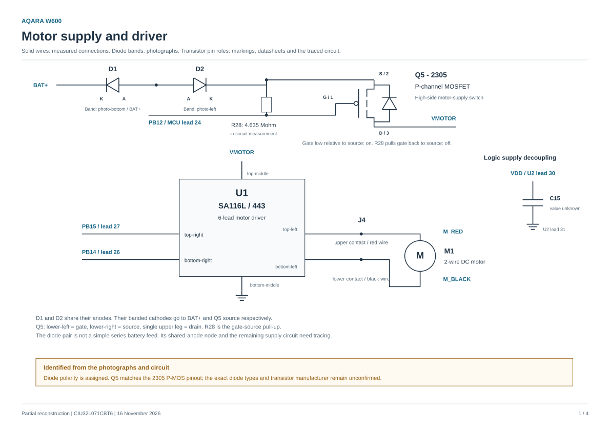
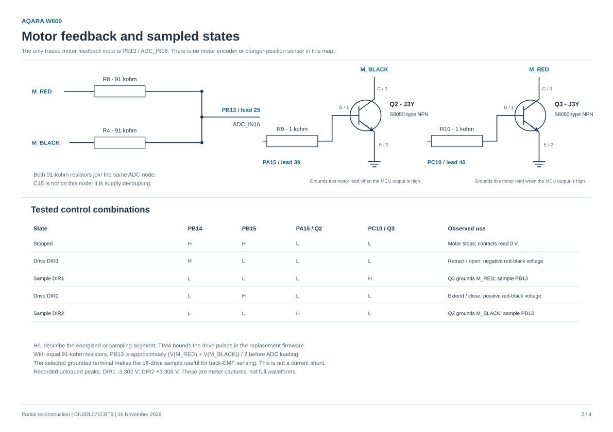

# Hardware

The W600 has a CIU32L071CBT6 controller, an MG24 radio running the original
Zigbee firmware, and a TM1652 LED display driver.

[Download the four-sheet schematic (PDF)](hardware/aqara-w600-hardware-map.pdf)
or use the editable SVG sheets:

1. [Motor supply and driver](hardware/w600-01-motor-supply.svg)
2. [Motor feedback and sampled states](hardware/w600-02-feedback.svg)
3. [Controller, radio, display and debug](hardware/w600-03-system.svg)
4. [Pin reference and reconstruction notes](hardware/w600-04-reference.svg)

The [connection list](hardware/w600-confirmed-nets.json) records the traced nets
and component identifications. The main board is marked `ST363LZBDR_A1`; the
display/radio board is `_B1`.

## Motor supply

Q5 is a `2305`-marked P-channel MOSFET. Its lower-left leg is gate (pin 1),
lower-right is source (pin 2), and single upper leg is drain (pin 3). PB12
controls the gate; R28 pulls it back to source. Pulling the gate below source
enables the motor supply. The marking and pinout match the
[BLM2305 datasheet](https://www.belling.com.cn/media/file_object/bel_product_en/BLM2305/datasheet/BLM2305_V2.3.pdf);
the exact manufacturer is unconfirmed.

D1's banded cathode connects to B+. D2's banded cathode connects to Q5 source.
The traced D1-top/D2-right connection joins their anodes. The symbols show
these polarities; the exact diode types and the rest of the supply circuit
still need identifying.

U1 is marked `SA116L / 443` and drives the two-wire motor from PB14/PB15.
Measured red-minus-black voltages were −3.302 V for retract/open and +3.308 V
for extend/close. The schematic uses photo-relative U1 terminal names rather
than assigning unverified manufacturer pin numbers.

## Motor feedback

Q2 and Q3 are `J3Y`-marked, S8050-type NPN transistors. Their lower-left leg
is base (1), lower-right is grounded emitter (2), and single upper leg is
collector (3), matching the
[S8050 datasheet](https://semiware.com/uploads/datasheet/S8050.pdf).
Q2 grounds the black motor lead through PA15/R9; Q3 grounds the red motor
lead through PC10/R10. R9 and R10 measured about 1 kΩ.

R4 and R8 each measured 91 kΩ. They connect the motor leads to the shared
PB13 / ADC_IN16 input. During an off-drive sample, the firmware grounds one
motor lead through Q2 or Q3, waits for settling, then reads PB13. With equal
resistors, the unloaded ADC node is approximately `(Vred + Vblack) / 2`.
This reads back-EMF, not motor current or plunger position.

## Controls and debug

Use the **CIU32L071 LQFP48 pinout**, not the different STM32L071 pinout.
MCU lead numbers below are not PCB `Pxx` pad labels.

| Connection | MCU signal / lead | Board pad |
| --- | --- | --- |
| Clockwise dial | PA2 / 13 | — |
| Counterclockwise dial | PB1 / 20 | — |
| Front button | PB8 / 47 | — |
| SWDIO | PA13 / 36 | — |
| SWCLK | PA14 / 37 | — |
| Reset, active low | NRST / 9 | P12 |
| Diagnostic UART TX | PA3 / 14 | P16 |

UART3 connects the controller to the radio through PD1/PD0 at 115200 8N1,
with active-low PA10/PA11 wake lines. PB6 drives the TM1652 through UART2
at 19200 8O1. Diagnostic UART TX uses 9600 8N1.

C15 is supply decoupling between MCU leads 30 and 31, not part of the motor
feedback input. Its capacitance is unmeasured.

## Remaining gaps

This is a partial reconstruction from continuity checks, component markings,
photographs, firmware and bench tests. The complete converter and rail wiring,
temperature front-end, R3/R5/C6/C7, exact radio/display-side pads and U4 remain
unmapped. Exact diode part numbers and transistor manufacturers are not confirmed.
